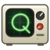

# Quanta Lab

A music visualizer where every scene is a small physics experiment. Quarks get yanked around by
the kick drum, a black hole merger chirps along with the track, a ferrofluid puddle bristles on
every bass hit. It runs in the browser (WebGL2 + Web Audio), has no dependencies, no build step,
and doesn't talk to the network.

It started as "what if the bar spectrum was a Schrödinger equation" and got out of hand. There are
28 experiments now.

> **Photosensitivity warning:** Quanta flashes, strobes and changes colour fast. It can trigger
> seizures in people with photosensitive epilepsy. If that's you or anyone watching, don't use it.



## Running it

**Windows:** double-click `Start-Quanta.cmd`. It starts a tiny local server in PowerShell and
opens Edge in an app window.

**Linux / macOS:** run `./start-quanta.sh` (needs `python3`, which you almost certainly have).
`--port 9000` and `--no-browser` do what they say.

**A server, behind Caddy:** see [Docker](#docker) below.

Then pick an input:

- **Desktop audio** captures whatever your computer is playing. In the share dialog choose
  *Entire screen* and tick *Share system audio*. Only the audio is used; the video track is
  switched off straight away.
- **Microphone**, an **audio file** (or drag one onto the window), or the **test signal**, a little
  synthwave loop generated live, if you just want to poke around.

`F` for fullscreen, `H` to hide the panels, and you have a screensaver.

### Desktop audio on Linux and macOS

Browsers only offer "share system audio" reliably on Windows. On Linux the launcher starts Chrome
with PulseAudio/PipeWire loopback switched on, which usually works, but only if Chrome wasn't
already running. If the checkbox is missing, the dependable route is to use your output's
*monitor* as a microphone: click **Microphone**, then in `pavucontrol` → *Recording* point the
browser at "Monitor of …", or make it the default input first:

```bash
pactl set-default-source "$(pactl get-default-sink).monitor"
```

On macOS you need a loopback device (BlackHole is free) selected as the microphone. Or share a
single browser tab, which does carry audio.

## The experiments

Every scene follows the same rule so you can read it without a legend: **bass moves things**,
**mids light them up**, **highs add sparkle**.

**Quantum stuff**
- *Quark Soup*: colour-charged quarks bound by gluon strings that snap into new pairs when
  stretched too far (string breaking). Drag a quark. Shake the browser window and the soup sloshes.
- *Wavefunction*: an actual 2D Schrödinger equation on the GPU. Kicks fire wave packets at a ring
  barrier that they partly tunnel through.
- *Bubble Chamber*: each kick is a collision; charged tracks curl in the field, neutrals decay
  into V's, and the photograph fades like a long exposure.
- *Double Slit*: photons land one at a time and slowly build the interference fringes. Every kick
  is a which-way measurement, and the fringes collapse until it passes.
- *Feynman Diagrams*: spacetime scrolls by and the music writes particle interactions onto it.

**Space**
- *Spacetime Fabric*: a grid bent by orbiting masses; the gravitational waves are the bass itself.
- *Starburst*: a few hundred thousand stars on a globe split into frequency wedges.
- *Event Horizon*: a lensed starfield and an accretion disk that stretches on kicks.
- *Supernova*: every kick collapses the core and blows the star apart; the camera takes the hit.
- *Pulsar*: snares are "glitches" that spin the neutron star up; magnetic braking slows it again.
- *Galaxy Collision*: two spirals tear tidal tails out of each other (about 64k stars on the GPU).
- *Black Hole Merger*: a minute-long loop. A lone hole, a companion falls in, they spiral together
  and chirp (watch the strain trace at the bottom), merge, and the remnant wears a spectrum corona
  until the next one arrives.
- *Comet*: ride along through perihelion; kicks are solar-wind gusts that kink the ion tail.
- *Jupiter*: a low flight over the cloud bands; kicks spin up storms, highs are lightning.
- *Wormhole*: an endless tunnel that surges on kicks.
- *Penrose Diagram*: the conformal diagram of a charged black hole, which goes on forever:
  universe, black hole, singularity, white hole, a new universe, again. A traveller follows a real
  timelike worldline through it, and each kick fires light rays along their light cone.
- *Meteor Shower*: streaks fan out from the radiant while the sky wheels overhead. Highs are
  faint quick meteors; every kick is a fireball that flares, breaks up and leaves a glowing
  train the wind slowly twists.

**Matter, fluids, fields**
- *Aurora*: curtains over a mountain lake; each fold is a mid band. Mid hits trigger substorms.
- *Ferrofluid*: a magnetic puddle that grows spikes when the coil (bass) surges. Drag the magnet.
- *Reaction–Diffusion*: BZ-style spiral waves in a petri dish; kicks scratch new spirals into being.
- *Plasma Globe*: plasma strings from the electrode to the glass; they writhe faster with the bass.
  Hold the mouse on the glass.
- *Tokamak*: a fusion plasma in its coils; every kick is an edge-localised mode erupting outward.

**Lab instruments**
- *Oscilloscope*: a three-channel scope on a slow timebase. The audio is split into lows, mids
  and highs, and the three beams roll across the screen together like a patient monitor, each
  drawing its band's envelope (kicks swell the green lane), with an erase bar running just ahead.
  There's an XY mode too.
- *Seismograph*: a three-pen helicorder drum. Black ink writes quakes on the kicks (P-wave, then
  S-wave, then the big surface waves), red writes volcanic tremor in the mids, blue writes
  micro-quake spikes on the highs.
- *Schlieren Camera*: the optical trick that shows air itself. A real 2D wave simulation: the
  speaker pushes pressure rings across the field on kicks, past a candle's heat plume.
- *Cyclotron*: particles spiral out between the copper dees, pushed at every gap crossing by an
  RF voltage that follows the bass, then shoot down the beam pipe onto a target. The gauge
  reads the beam energy.

**Odd ones**
- *Lorenz Attractor*: three chaotic tracers that start a hair apart and don't stay that way.
- *Pendulum Wave*: 24 tuned pendulums drifting in and out of step; each bob is a mid band.

Each experiment has its own knobs at the bottom of the setup window.

## Controls

| Key | Does |
| --- | --- |
| `Space` / `→` / `←` | next / previous experiment |
| `1`–`9`, `0` | experiment 1–10 (`Shift` adds 10, `Alt` adds 20) |
| `P` / `Shift+P` | next / previous palette |
| `R` | invent a palette (there's no undo) |
| `E` / `C` | shuffle effects / clear them |
| `X` | auto-shuffle effects and palettes |
| `A` | auto-cycle experiments |
| `S` / `Esc` | setup window |
| `F` or double-click | fullscreen |
| `H` | hide everything |
| `M` | mute file / test-signal playback |

URL parameters: `?scene=<id>` (`quarks`, `supernova`, `penrose`, … the ids are in each
`js/scenes/*.js`) and `?mute=1`.

## Effects and palettes

The setup window stacks post effects on top of any scene: mirror, kaleidoscope, fractal tiling,
space bend, echo trails, rotation, cel shading with ink, halftone, scanlines, chromatic
aberration, a negative flash on kicks and hue drift. They glide in and out instead of snapping.
There are 14 palettes I picked by hand and a random one (`R`) that's right more often than
you'd expect.

## How the kick detection works

This took longer than any of the scenes, so it gets a section.

A naive "bass is loud" trigger fires constantly on modern music, because the bassline is loud
all the time. Quanta looks at the *attack* instead: in the 35–100 Hz band it compares a fast and a
slow envelope of the band's power in dB, so a kick on top of a big bassline still registers as a
jump. That jump is measured against the *typical* recent jump, not the loudest one, so one huge
hit doesn't make every following kick look small. After a hit the detector disarms until the band
dips a few dB, so a long 808 is one event, not twelve. Below about −46 dBFS nothing counts at
all, because in quiet passages the noise floor wobbles by tens of dB and reads as phantom kicks.

It also starts out cautious. A new source (or music after a few seconds of silence) begins with
a high guess for a typical hit and learns it from above, and the hits and onsets ease in over the
first few seconds, so the opening of a track doesn't set everything off before Quanta knows how
loud it is.

All of that is tunable under *Band response* in the setup window (threshold, level gate, decay),
alongside a drive slider per band.

## Docker

The container is plain nginx serving the static files on port 8080. Every push to `master`
runs CI, which builds it and publishes `ghcr.io/opensrcerer/quantaviz` (tagged `latest` and with
the commit sha) after checking that the pushed image actually serves the app. So on the server:

```bash
docker compose up -d
```

pulls the published image, and `docker compose up -d --build` builds from your checkout instead.

That publishes it on `127.0.0.1:8477` only, so a Caddy on the same host can front it:

```
quanta.example.com {
	reverse_proxy 127.0.0.1:8477
}
```

There's a copy of that in `deploy/Caddyfile`. If Caddy itself runs in Docker, put both on one
network and use `reverse_proxy quanta:8080` instead (the compose file has a commented example).

**It has to be served over HTTPS** (or from localhost). Browsers only allow microphone and
screen-audio capture in a secure context, which Caddy gives you for free. Over plain http from
another machine, the file and test-signal inputs still work and the capture buttons won't.

## Performance

Built for 144 Hz on a desktop GPU. It measures your refresh rate on start, and with *Adaptive
quality* on it lowers the render resolution when frames run long and raises it again when there's
headroom. The readout bottom right shows achieved / target fps and the resolution. The heavy ones
are Tokamak, Ferrofluid and Galaxy Collision; Wavefunction and Starburst have their own size knobs.

## Known quirks

- Firefox can't capture system audio at all. Use Chrome or Edge, or the monitor-as-microphone trick.
- On Wayland the browser doesn't report the window position, so the "shake the window" physics
  in Quark Soup, Starburst and Spacetime do nothing.
- The bpm readout guesses from the kicks. It's usually right.
- Opening `index.html` straight from disk mostly works, but browsers are stricter about capture
  on `file://` pages, so use one of the launchers.

## Layout

```
index.html, css/style.css      the start dialog, readouts and setup window
logo.svg, favicon.svg
js/gl.js                       tiny WebGL2 toolkit + shared GLSL (noise, palette, band lookups)
js/audio.js                    capture, analysis, kick/onset detection, the test-signal synth
js/post.js                     bloom, the effects stack, tonemapping
js/main.js                     scene registry, settings, UI, render loop, adaptive quality
js/scenes/*.js                 one file per experiment
Start-Quanta.cmd, serve.ps1    Windows launcher
start-quanta.sh                Linux / macOS launcher
Dockerfile, deploy/            container + nginx and Caddy configs
```

### Adding an experiment

Make `js/scenes/yours.js`, call `VIZ.registerScene({ id, name, blurb, params, create })`, add a
`<script>` tag in `index.html`. A scene implements `resize(w, h)`, `render(target, audio, u)` and
`dispose()`. The full contract, including everything `audio` and `u` hand you, is the comment at
the top of `js/main.js`. `js/scenes/horizon.js` is the shortest example. To fire something once
per kick, `new VIZ.KickTrigger()` and call `update(audio.kick)` every frame; it returns the hit's
strength on the frame the kick peaks.

The one rule worth keeping: make the scene's biggest visible change follow `uKick`.
